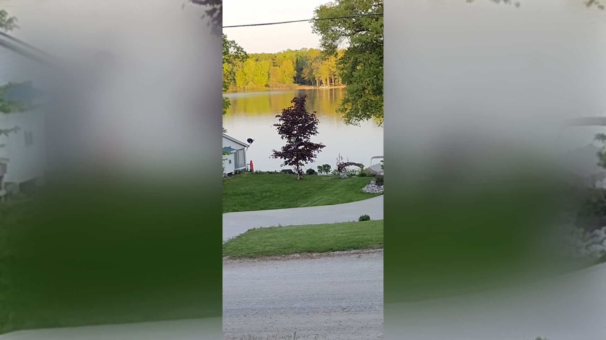

# Immich Screensaver for Omarchy

Your Immich library, on your idle screen. Photos are fitted whole to the screen
and the space they cannot fill is filled with a blown-up, blurred copy of the
same photo — so a portrait never sits in black bars, and a panorama never gets
cropped to fit.

Built as an Omarchy shell plugin, so it installs with one command and survives
`omarchy update`.

| Portrait | Landscape |
| --- | --- |
|  |  |

Both are real renders from the plugin at 1920×1080 — the portrait shows the
blurred side fill, the 16:9 photo covers the screen with nothing to fill.

## Requirements

- Omarchy on Hyprland 0.56 or newer (needs the Quickshell shell, `omarchy.idle`,
  and Lua-configured Hyprland).
- `curl`, `jq` and `lua` on `PATH`. All three are hard dependencies of the
  Omarchy base system (`jq` is pulled in by `omarchy`, `lua` by `hyprland`), so
  there is nothing to install.
- An Immich server you can reach over HTTP(S), and an API key.

## Install

**1. Add the plugin**

```bash
omarchy plugin add https://github.com/offback/omarchy-immich-screensaver.git --enable
```

That clones it into `~/.config/omarchy/plugins/io.github.offback.immich-screensaver/`
and the shell mounts it. Change the id first if you forked this under a different
GitHub name: it appears in `manifest.json` and must match the folder name.

**2. Create the API key file**

In Immich: *Account Settings → API Keys → New API Key*, with these permissions:

| Permission | Needed for |
| --- | --- |
| `asset.read` | listing photos, timestamps, EXIF |
| `asset.view` | fetching the image files (thumbnails/previews) |
| `album.read` | listing albums, reading a chosen album |
| `asset.download` | only if you set `sizing.quality = "fullsize"` |

Nothing else: no admin scopes, no write/upload/delete. The key never goes in this
repo or in the config file — it lives in its own `0600` file:

```bash
install -d -m 700 ~/.config/omarchy/immich-screensaver
install -m 600 /dev/null ~/.config/omarchy/immich-screensaver/api-key
omarchy-launch-editor ~/.config/omarchy/immich-screensaver/api-key
```

Paste the key, save, done. (`read -rsp` works too if you prefer the terminal.)

**3. Turn off the stock screensaver**

The stock one is a terminal running `ttfx`. Ours replaces it, so:

```bash
jq '.idle.screensaver = 0' ~/.config/omarchy/shell.json > /tmp/shell.json \
  && mv /tmp/shell.json ~/.config/omarchy/shell.json
```

Or edit `~/.config/omarchy/shell.json` by hand — `idle.screensaver: 0` disables
it. Leave `idle.lock` alone: our slideshow cancels itself when the session locks,
and the Omarchy lock screen draws above it either way.

**4. Check it**

```bash
~/.config/omarchy/plugins/io.github.offback.immich-screensaver/scripts/immich.sh check \
  ~/.config/omarchy/immich-screensaver/config.lua
```

```
server  https://immich.example.com
version 3.4.0
albums  28  (album.read ok)
assets  readable  (asset.read ok)
images  157183 bytes for one preview  (asset.view ok)
```

Then wait for the idle timeout, or force it immediately:

```bash
IMMICH_SCREENSAVER_IDLE_MS=4000 quickshell -p ~/.config/omarchy/plugins/io.github.offback.immich-screensaver
```

Any key or pointer movement dismisses it; the session lock cancels it.

## Configuration

`~/.config/omarchy/immich-screensaver/config.lua` — a short Lua file, because
Lua is already on every Omarchy box (Hyprland's own config is Lua here) and it
allows comments. It hot-reloads on save: no shell restart.

Missing keys fall back to the defaults below; unknown keys, wrong types and
out-of-range values are reported on the shell console instead of breaking the
slideshow. `config.example.lua` in this repo is the same file with comments.

| Key | Default | Meaning |
| --- | --- | --- |
| `server.url` | `https://immich.example.com` | Your Immich server |
| `server.api_key_file` | `~/.config/omarchy/immich-screensaver/api-key` | Path to the key file, `0600` |
| `server.verify_tls` | `true` | `false` only for a self-signed cert |
| `source.albums` | `{}` (whole library) | Album names or UUIDs |
| `source.mode` | `shuffle` | `shuffle`, `newest`, `oldest` |
| `source.stills_only` | `true` | Skip videos and live-photo motion |
| `source.from` / `.to` | `nil` | ISO date range, e.g. `"2024-01-01"` |
| `display.idle_seconds` | `150` | Idle time before the slideshow starts; `0` disables |
| `display.seconds_per_photo` | `30` | How long each photo stays |
| `display.crossfade_ms` | `1200` | Crossfade duration |
| `display.ken_burns` | `true` | Very slow zoom while a photo is up |
| `display.order` | `shuffle` | `shuffle` or `sequential` |
| `display.prefetch` | `3` | Photos downloaded ahead of the one on screen |
| `sizing.quality` | `preview` | `preview` (~1440px) or `fullsize` (4K panels) |
| `sizing.fill` | `blur` | What fills the uncovered space: `blur`, `black`, `solid` |
| `sizing.blur_strength` | `0.8` | `0`–`1.5` |
| `sizing.darken` | `0.12` | How much the blurred fill is dimmed, `0`–`0.9` |
| `overlay.clock` / `.date` / `.caption` | `false` | Text over the photo (not implemented yet) |
| `monitors.mode` | `same` | `same` photo on every screen, or `independent` |
| `cache.dir` | `~/.cache/omarchy-immich-screensaver` | Image + manifest cache |
| `cache.max_gb` | `2` | Cache size cap, evicted oldest-first |
| `cache.refresh_minutes` | `60` | How often the photo list is refreshed |

Minimal working config:

```lua
return {
  server = { url = "https://immich.example.com" },
  display = { idle_seconds = 300, seconds_per_photo = 20 },
}
```

## How it works

```
manifest.json            plugin manifest, validated by `omarchy plugin validate`
Service.qml              idle trigger, queue, prefetch, per-monitor overlays
components/Slide.qml     one photo: blurred crop fill + fitted overlay
components/Crossfade.qml two Slides, cross-dissolved, old one freed after
scripts/config-to-json.lua  config.lua -> merged, validated JSON (Lua, no deps)
scripts/immich.sh        the only thing that talks to Immich (curl + jq)
config.example.lua       documented config
preview.qml / shell.qml  development harness only, not loaded by the shell
```

Two constraints shaped this design:

- The shell has no HTTP client and QML's `Image` cannot send request headers, so
  every authenticated fetch happens in `scripts/immich.sh` and the UI only reads
  local files from the cache.
- Plugins run inside the shell's single Quickshell process, so nothing blocks:
  fetches are short-lived child processes, downloads are prefetched, and a
  malformed config leaves the last good one running.

Rendering is two stacked `Image`s — `PreserveAspectCrop` blurred underneath,
`PreserveAspectFit` on top — with `MultiEffect` doing the blur. A 50-megapixel
photo is decoded at screen size, not native size.

## Uninstall

```bash
omarchy plugin remove io.github.offback.immich-screensaver
jq '.idle.screensaver = 150' ~/.config/omarchy/shell.json > /tmp/shell.json \
  && mv /tmp/shell.json ~/.config/omarchy/shell.json
```

Cache and key are yours to keep or delete:
`rm -rf ~/.cache/omarchy-immich-screensaver ~/.config/omarchy/immich-screensaver`.

## Troubleshooting

| Symptom | Cause |
| --- | --- |
| Photo list loads, every image 403s | `asset.view` missing from the key |
| `check` fails at the albums line | `album.read` missing, or the key is wrong |
| 404 on individual photos | Immich has no media for that asset; they are skipped |
| Nothing happens when idle | `display.idle_seconds` is `0`, or another idle inhibitor is active |
| Slideshow flashes and disappears | pointer/cursor over the screen moving during the arm window |
| Bar and notifications vanish | plugin threw inside the shell: `omarchy restart shell`, then report it |
| Config changes ignored | check the shell console for `immich-screensaver config errors:` |

Config and script problems are reported on the shell's console
(`journalctl --user -f` or the terminal that launched it).

## Development

```bash
# run the plugin in a throwaway shell, no effect on the running desktop
IMMICH_SCREENSAVER_IDLE_MS=4000 QT_ASSUME_STDERR_HAS_CONSOLE=1 \
  quickshell -p .

# render one photo in a plain window, cycling cached previews
QML_XHR_ALLOW_FILE_READ=1 QT_ASSUME_STDERR_HAS_CONSOLE=1 \
  /usr/lib/qt6/bin/qml preview.qml

# the data layer, without the UI
scripts/immich.sh check <config.lua>
scripts/immich.sh list  <config.lua> | jq length
scripts/immich.sh fetch <config.lua> <asset-id>
scripts/immich.sh prune <config.lua>

# before publishing
omarchy plugin validate .
```

## License

MIT — see `LICENSE`.
